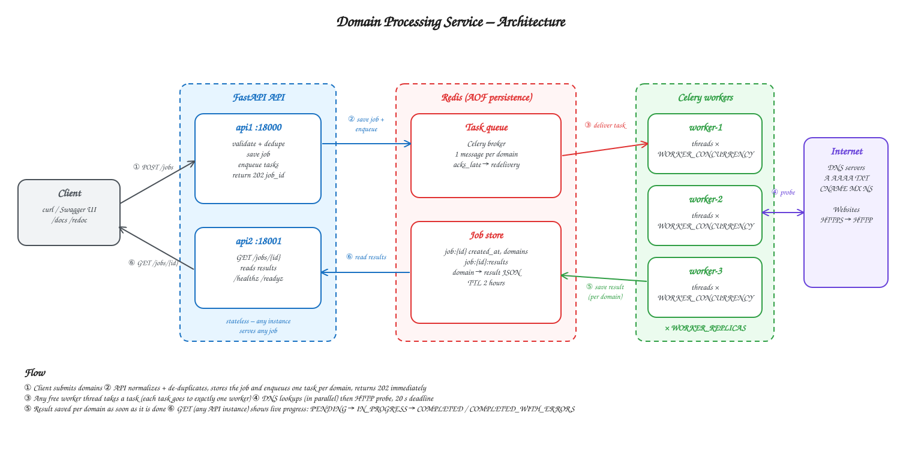

# Asynchronous Domain Processing Service

A backend service that accepts a list of domains, processes them asynchronously (DNS records, IP addresses,
HTTP/HTTPS status, page title, response time) and lets clients poll for per-domain status and results.

**Stack:** Python 3.12 • uv • FastAPI • Pydantic • Celery • Redis • asyncio (httpx + dnspython)

**Contents:**

1. [Running locally](#1-running-locally)
2. [API usage examples](#2-api-usage-examples)
3. [Tests](#3-tests)
4. [Architecture and major components](#4-architecture-and-major-components)
5. [Key design decisions](#5-key-design-decisions)
6. [Assumptions](#6-assumptions)
7. [Known limitations](#7-known-limitations)
8. [What I would improve with more time](#8-what-i-would-improve-with-more-time)

---

## 1. Running locally

### With Docker (recommended)

Requires Docker with Compose.

```bash
docker compose up --build -d

# Optional: choose how many app and worker containers to run
APP_REPLICAS=2 APP_PORTS=18000-18001 WORKER_REPLICAS=2 WORKER_CONCURRENCY=10 docker compose up -d

docker compose ps
```

By default this starts Redis, one API instance (`localhost:18000`) and one Celery worker. The optional command scales
them to 2 apps (`localhost:18000`, `localhost:18001`) and 2 workers (2 × 10 = 20 domains in parallel).

| Action | Command |
|---|---|
| Scale APIs | `APP_REPLICAS=3 APP_PORTS=18000-18002 docker compose up -d` (one host port per API container) |
| Scale workers | `WORKER_REPLICAS=3 WORKER_CONCURRENCY=20 docker compose up -d` (3 × 20 = 60 domains in parallel) |
| Worker logs | `docker compose logs -f worker` |
| Stop | `docker compose down` (add `-v` to wipe Redis data) |

API documentation (once running):

- Swagger UI (try requests in the browser): http://localhost:18000/docs
- ReDoc (readable reference): http://localhost:18000/redoc
- OpenAPI schema: http://localhost:18000/openapi.json

Redis UI (RedisInsight, bundled in the `redis/redis-stack` image): http://localhost:18080. It is already connected,
so you can browse `job:*` keys and the Celery queue. Redis itself (port 6379) is only reachable inside the Docker
network; the app uses `redis://redis:6379/0`. For a shell instead: `docker compose exec redis redis-cli`.

### Without Docker

Dependencies are managed with [uv](https://docs.astral.sh/uv/) (`pyproject.toml` + `uv.lock`).

```bash
uv sync                                                                 # create .venv, install deps
redis-server --appendonly yes                                           # any local Redis
uv run uvicorn app.main:app --port 18000                                # API
uv run celery -A app.worker worker --pool=threads --concurrency=10      # worker (separate terminal)
```

### Configuration

| Variable | Default | Meaning |
|---|---|---|
| `REDIS_URL` | `redis://localhost:6379/0` | Broker and job store |
| `WORKER_REPLICAS` | `1` | Worker containers (compose) |
| `WORKER_CONCURRENCY` | `10` | Parallel domains per worker |
| `TASK_DEADLINE_SECONDS` | `20` | Hard limit per domain |
| `VISIBILITY_TIMEOUT_SECONDS` | `300` | Redelivery delay for tasks of a crashed worker |
| `JOB_TTL_SECONDS` | `7200` | How long jobs/results are kept (2 hours) |
| `APP_REPLICAS` | `1` | API containers (compose) |
| `APP_PORTS` | `18000` | Host port, or a range with at least `APP_REPLICAS` ports (e.g. `18000-18002`) |
| `REDIS_UI_PORT` | `18080` | Host port for the RedisInsight UI |

---

## 2. API usage examples

| Method | Path | Description |
|---|---|---|
| `POST` | `/jobs` | Submit 1–50 domains; returns a job ID immediately (`202`) |
| `GET` | `/jobs/{job_id}` | Job status and per-domain results |
| `GET` | `/healthz` | Liveness |
| `GET` | `/readyz` | Readiness (checks Redis) |

**Submit a job**

```bash
curl -s -X POST http://localhost:18000/jobs \
  -H 'Content-Type: application/json' \
  -d '{"domains":["example.com","google.com","invalid.example","EXAMPLE.COM"]}'
```

```json
{"job_id": "eb0d97b1-a966-4a74-bde8-bcc3a20a0aa6", "status": "PENDING", "total": 3}
```

`total` is 3 because `EXAMPLE.COM` is a duplicate of `example.com`.

**Get status and results** (any API instance can serve any job)

```bash
curl -s http://localhost:18000/jobs/eb0d97b1-a966-4a74-bde8-bcc3a20a0aa6
```

```json
{
  "job_id": "eb0d97b1-a966-4a74-bde8-bcc3a20a0aa6",
  "status": "COMPLETED_WITH_ERRORS",
  "created_at": "2026-11-15T14:58:58+00:00",
  "total": 3,
  "processed": 3,
  "results": [
    {"domain": "google.com", "status": "COMPLETED", "ip_addresses": ["142.251.221.238"],
     "dns": {"A": ["142.251.221.238"], "AAAA": [], "TXT": ["v=spf1 include:_spf.google.com ~all"],
             "CNAME": [], "MX": ["10 smtp.google.com."], "NS": ["ns1.google.com."]},
     "scheme": "https", "http_status": 301, "title": "301 Moved", "response_time_ms": 104.6},
    {"domain": "invalid.example", "status": "FAILED", "ip_addresses": [],
     "error": "DNS A record not found or DNS lookup failed"},
    {"domain": "not a domain", "status": "FAILED", "ip_addresses": [], "error": "Invalid domain name"}
  ]
}
```

While processing, unfinished domains appear as `{"domain": "...", "status": "PENDING"}` or `"IN_PROGRESS"`.

**Statuses** (enums in `app/schemas.py`)

- Job: `PENDING` → `IN_PROGRESS` → `COMPLETED` | `COMPLETED_WITH_ERRORS`
- Domain: `PENDING` → `IN_PROGRESS` → `COMPLETED` | `FAILED`

Job status (`JobStatus`, top-level `status`; derived from the domain statuses on every read):

| Status | Meaning |
|---|---|
| `PENDING` | Job accepted and queued; no domain has started yet |
| `IN_PROGRESS` | At least one domain has started or finished, but not all are finished |
| `COMPLETED` | Every domain finished and none failed |
| `COMPLETED_WITH_ERRORS` | Every domain finished and at least one is `FAILED` (partial success) |

Domain status (`DomainStatus`, `status` of each item in `results`):

| Status | Meaning |
|---|---|
| `PENDING` | Waiting in the queue; no worker has picked it up yet |
| `IN_PROGRESS` | A worker is probing it (DNS, then HTTP) |
| `COMPLETED` | DNS resolved to public IPs. HTTP result is included (`http_status`, `title`, `response_time_ms`); if the web server was unreachable, `http_error` explains why and the DNS data is still returned |
| `FAILED` | No usable result; `error` explains why: invalid domain name, IP address given, DNS did not resolve, non-public IPs, or the 20 s deadline was exceeded |

Health status (`HealthStatus`):

| Endpoint | Status | Meaning |
|---|---|---|
| `GET /healthz` | `OK` | The API process is running (liveness) |
| `GET /readyz` | `READY` | The API can reach Redis and accept jobs (readiness); otherwise `503` |

**Status codes:**

| Code | Meaning |
|---|---|
| `202` | Job accepted |
| `200` | OK |
| `404` | Unknown job |
| `422` | Invalid body or malformed job ID |
| `503` | Redis or the queue is unavailable |

---

## 3. Tests

```bash
uv sync
uv run pytest -q          # 31 tests, no external services needed (uses fakeredis)
```

What is tested and why:

- **API contract**, because it's the public interface:
  - 202 + pending, de-duplication, one task per unique domain, 404/422, readiness;
  - the request schema rejects bad payloads;
  - the response schema has the documented shape;
  - job status is derived correctly from the enums.
- **End-to-end flow through the real Celery task function**: partial failure → `COMPLETED_WITH_ERRORS`, order preserved.
- **Failure handling**: task deadline, unexpected crash, queue outage on submit (503 and no orphan job).
- **Redelivery idempotency**: a redelivered task can't move a finished domain back to `IN_PROGRESS`.
- **Processor**: malformed input, DNS failure/timeout, server down keeps DNS data, private IPs, title parsing.

Network calls are mocked so tests are fast and deterministic. The full Docker stack was also verified
manually: real domains, cross-instance reads, Redis restart.

---

## 4. Architecture and major components



> Diagrams are drawn in Excalidraw. To edit, open `docs/architecture.excalidraw` or `docs/worker.excalidraw`
> at [excalidraw.com](https://excalidraw.com) (menu → Open). The `.svg` files are the exported images.

Three independently scalable parts, connected only through Redis:

| Component | Role | Scales by |
|---|---|---|
| **FastAPI API** (`api` × `APP_REPLICAS`) | Validates input, accepts jobs and returns `202` immediately; serves status/results. Stateless. | More instances behind a load balancer |
| **Redis** | (a) Celery task queue, (b) job store for status and results. AOF persistence. | Managed Redis / replication |
| **Celery workers** (`worker` × `WORKER_REPLICAS`) | Dedicated background processes that probe domains. Never serve HTTP. | `WORKER_REPLICAS` (containers) × `WORKER_CONCURRENCY` (threads) |

### Request flow

1. `POST /jobs` validates the body (Pydantic), normalizes and de-duplicates domains, stores the job in Redis,
   enqueues **one Celery task per domain** and returns **202** without waiting.
2. Any free worker thread takes a task (each task goes to exactly one worker), marks the domain `IN_PROGRESS`,
   runs the probe under a 20 s deadline, and writes the result to Redis:
   - the 6 DNS queries (A, AAAA, TXT, CNAME, MX, NS) run concurrently;
   - then HTTPS, falling back to HTTP;
   - then the page title and response time are captured.
3. `GET /jobs/{id}` (any API instance) reads the job and its per-domain results and derives the overall status.
   Each domain appears as soon as it finishes, and a slow domain never blocks the others.

### Source code

| File | Responsibility |
|---|---|
| `app/main.py` | FastAPI app: endpoints, de-duplication, health checks, Swagger/ReDoc |
| `app/schemas.py` | API contract: Pydantic request/response models and status enums |
| `app/storage.py` | Redis job store (async for API, sync helpers for workers) and job status calculation |
| `app/worker.py` | Celery configuration and the per-domain task |
| `app/processor.py` | Domain validation, async DNS lookups, HTTP probe, HTML title parsing |
| `tests/` | Unit and flow tests (see [Tests](#3-tests)) |
| `docker-compose.yml`, `Dockerfile` | Local multi-instance setup (Redis, 2 APIs, scalable workers) |

**Redis data model** (keys expire after `JOB_TTL_SECONDS`):

- `job:{id}`: hash with `created_at` and `domains` (JSON list, keeps submission order).
- `job:{id}:results`: hash of `domain → result JSON`. A missing entry means `PENDING`.

---

## 5. Key design decisions

| Decision | Why | Alternative considered |
|---|---|---|
| Celery + Redis | Standard, well-understood queue; jobs shared across instances and survive restarts | FastAPI `BackgroundTasks`/asyncio-only: jobs lost on restart and not shared between instances. Postgres `SKIP LOCKED` queue: fewer components but custom queue code |
| Redis as job store too | One dependency for queue and results; results are small JSON blobs | Postgres if we need querying/history/reporting |
| One task per domain | Domains succeed/fail/retry independently; load spreads over all workers | One task per job: a slow domain blocks the others |
| `task_acks_late` + `task_reject_on_worker_lost` | If a worker crashes mid-task, the task is redelivered (at-least-once) | Early ack: tasks lost on crash |
| Idempotent result writes | Re-running a task overwrites the same field; `HSETNX` for `IN_PROGRESS` so a redelivery never "un-finishes" a domain | — |
| Pydantic request/response models + `StrEnum` statuses | Input rejected early with clear 422s; output has a fixed, documented shape; no status typos | Plain dicts and strings |
| asyncio inside each task | DNS queries run concurrently; httpx/dnspython are async | Blocking libraries |
| Threads worker pool | Work is network I/O, not CPU, so threads are cheap and sufficient | Prefork for CPU-bound work |
| Redis AOF (`--appendonly yes`) | Queue and results survive Redis restarts | Managed Redis with replication in production |

---

## 6. Assumptions

- Max 50 domains per job; de-duplication is per job (the same domain in another job is processed again).
- A malformed domain doesn't reject the whole job: it is accepted and reported as `FAILED`.
- HTTPS is tried first; HTTP only if HTTPS fails at transport level. 3xx/4xx/5xx are valid observations.
- Redirects are **not** followed (avoids being redirected into internal networks); the redirect status is reported.
- Domains resolving to private/loopback addresses are not probed over HTTP (basic SSRF protection).
- If DNS resolves but the web server is unreachable, the domain is `COMPLETED` with an `http_error`,
  because the DNS data is still useful.
- Results are kept for 2 hours: clients check status immediately or within minutes, and jobs finish in seconds.
  Configurable with `JOB_TTL_SECONDS`.
- No authentication/login: this is an assignment that runs locally, so the API is open. Anyone who knows a `job_id`
  can read that job; job IDs are random UUIDs, so they can't be guessed.
- Results are intentionally **not cached** across jobs: DNS answers and site availability change constantly
  (round-robin, geo-DNS, failover, outages), so every job probes live.

**How the expected scenarios are handled:**

| Scenario | Behavior |
|---|---|
| Malformed domain (`a b.com`, URLs, IPs, `localhost`) | Accepted in the job, reported as `FAILED` with a reason; no network calls |
| Domain does not resolve | `FAILED`, error `DNS A record not found or DNS lookup failed` |
| Remote server unavailable | DNS data kept; `COMPLETED` with `http_error` |
| Request takes too long | DNS timeout 4 s, HTTP timeout 5 s, whole task deadline 20 s → `FAILED` with `Processing deadline exceeded` |
| Same domain submitted twice | Normalized (case, trailing dot, IDN) and de-duplicated within the job |
| Mixed success/failure | Each domain has its own status; job becomes `COMPLETED_WITH_ERRORS` |
| Queue unavailable on submit | Job is removed and API returns `503` (client can retry) |
| Worker crash | Task redelivered after the visibility timeout (300 s) |

---

## 7. Known limitations

- At-least-once processing: a domain may be probed twice after a worker crash (results are idempotent).
- If enqueueing fails halfway through a job, already-queued tasks still run; their results expire with the TTL.
- SSRF protection checks DNS answers before the request, but httpx resolves again (DNS rebinding is possible). Production should restrict outbound network access.
- No authentication, rate limiting or metrics.
- Redis is a single instance; capacity has not been load tested.

---

## 8. What I would improve with more time

- **Authentication (login)**: API keys per client (FastAPI security dependency on every endpoint), storing the
  owner with each job so clients can only read their own jobs. OAuth2/JWT if users log in through an identity provider.
- **Per-client rate limiting**: cap jobs per minute per API key to protect workers and the sites being probed.
- **Retries with backoff** for transient DNS/HTTP errors (e.g. one retry after 1–2 s) before marking a domain `FAILED`.
- **Monitoring**: metrics (queue length, task duration, failure rate), structured logs with `job_id`, Celery Flower.
- **Webhook on completion**, so clients don't have to poll `GET /jobs/{id}`.
- **Postgres for results** if history or reporting is needed; Redis stays as the queue.
- Probably Better folder structure.